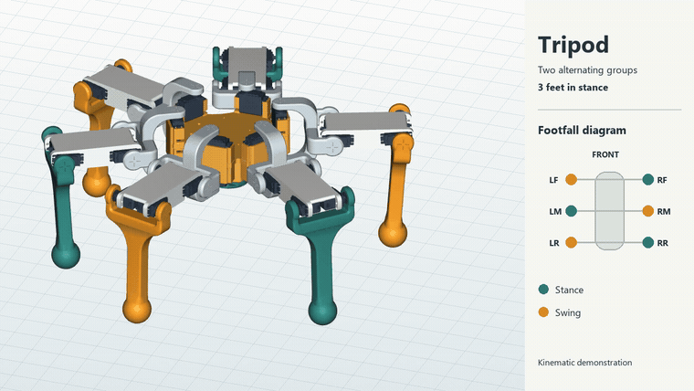
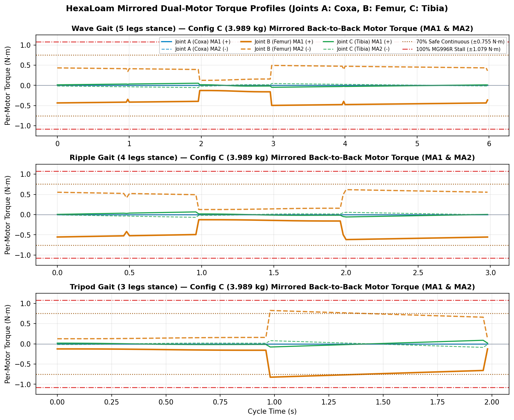

  

# HexaLoam — Modular 3D-Printable Hexapod Robot Platform with LiDAR

  
  
  
  

**HexaLoam is a modifiable six-legged robot (hexabot) platform** for agriculture, inspection, LiDAR/LOAM mapping, education, and robotics research. The repository provides editable SOLIDWORKS CAD and 3D-print files for the chassis, six leg sets, and LiDAR cover. The reference assembly shows MG996R servos and an RP-Lidar sensor on the chassis.

Published by **HexaLoam contributors**. [Project homepage and research overview](https://equesai.github.io/HexaLoam/)

**Watch the hexapod walk** · [Gait comparison hub](https://equesai.github.io/HexaLoam/videos/) · [Tripod gait](https://equesai.github.io/HexaLoam/videos/tripod/) · [Ripple gait](https://equesai.github.io/HexaLoam/videos/ripple/) · [Wave gait](https://equesai.github.io/HexaLoam/videos/wave/) · [Reproduce the animations](docs/walking.md#reproduce-the-videos)

[360° assembly video](docs/media/assembly-orbit.mp4?raw=1) · [Multi-angle CAD gallery](docs/gallery.md)

This is a **mechanical starting point**. The designer is expected to finish the robot around the intended application, including the payload, mounting adapters, actuators, controller, battery, wiring, firmware, and validation.

[Designer guide and examples](docs/designer-guide.md) · [Main SOLIDWORKS assembly](Full_Robot_Assembly.SLDASM) · [STL and 3MF print files](Printables/)

## Start developing

| If you want to… | Start here |
| --- | --- |
| Bring a chassis or leg mesh into Unity or Unreal Engine | [Visual assets and import instructions](docs/simulation-guide.md#visual-meshes) |
| Study how a foot force loads three joints | [Runnable MATLAB example](docs/simulation-guide.md#single-leg-static-study) |
| Change a gait and render it from the assembly geometry | [Walking demonstrations and reproduction commands](docs/walking.md#reproduce-the-videos) |
| Develop the complete 18-joint model and agricultural experiment | [Engineering roadmap and acceptance tests](docs/development-roadmap.md) |
| Share a modification, classroom exercise or benchmark | [Contribution guide](CONTRIBUTING.md) · [Citation metadata](CITATION.cff) |

## Example applications

| Field | Example project | What the designer would add |
| --- | --- | --- |
| Agricultural robotics | Greenhouse or crop-row scouting | A camera or environmental sensor, a protective mount, and clearance for plants and soil |
| Inspection | Visual checks in a workshop or equipment aisle | A camera, lighting, and a mount that keeps the payload clear of the legs |
| Mapping | Indoor LiDAR scanning and mapping experiments | A controller or onboard computer, sensor integration, and mapping software |
| Education | A classroom hexapod for studying gait and kinematics | A controller, servo power, and firmware for repeatable gait exercises |
| Robotics research | Comparing locomotion on different surfaces | An IMU or other instrumentation, data logging, and repeatable test setups |

These are example configurations for designing a build. In addition to the mechanical CAD, the repository now includes complete electronics schematics, firmware, Raspberry Pi control software, URDF, and progressive testing guides—with software/simulation checks validated and physical hardware tests marked pending until bench assembly.

## Electronics, firmware, wiring & torque analysis

HexaLoam shares one canonical 18-joint mapping ([JOINT_MAPPING.md](control/robot-configuration/JOINT_MAPPING.md), [hexaloam_config.json](control/robot-configuration/hexaloam_config.json)) and CAD-derived 3R kinematics (`L1 = 86.53 mm`, `L2 = 121.06 mm`, `L3 = 202.50 mm`) across four electronic control configurations:

| Configuration | Controller & Bus | Top + 3S LiPo (kg) | Total Mass (kg) | Wave 5-Leg (N·m) | Ripple 4-Leg (N·m) | Tripod 3-Leg (N·m) | Max Extra Payload (70% Wave / Ripple) |
|---|---|---:|---:|---:|---:|---:|---|
| **A — Standalone Mega** | Arduino Mega 2560 (`D22..D39`) | 0.507 | 3.793 | 0.971 (45.0%) | 1.266 (58.7%) | 1.759 (81.5%) | **+2.11 kg** / **+0.73 kg** |
| **B — Standalone ESP32** | ESP32 + Dual PCA9685 (`0x40`, `0x41`) | 0.519 | 3.805 | 0.974 (45.1%) | 1.270 (58.9%) | 1.764 (81.8%) | **+2.10 kg** / **+0.72 kg** |
| **C — RPi + 1× ESP32** | Raspberry Pi 4/5 + ESP32 (`460800 baud`) + RP-Lidar | 0.703 | 3.989 | 1.021 (47.3%) | 1.332 (61.7%) | 1.850 (85.7%) | **+1.91 kg** / **+0.53 kg** |
| **D — RPi + 2× ESP32** | Raspberry Pi 4/5 + Left/Right ESP32s (`0x40` each) | 0.733 | 4.019 | 1.029 (47.7%) | 1.342 (62.2%) | 1.864 (86.4%) | **+1.88 kg** / **+0.50 kg** |

- **Slicer-Verified Mass & Dual-Motor Torque (Simulation Validated):** Using Bambu Studio PLA+ G-code weights (support negated: `Robot_Base` `174.67 g`, `L1` `59.64 g × 6`, `L2` `48.33 g × 6`, `L3` `73.51 g × 6`, `LidarCover` `42.68 g` = `1.306 kg`) + 36 MG996R servos (`1.980 kg`, 2 motors/joint = `2.157 N·m` stall @ 6.0 V) + 3S 5000 mAh LiPo (`0.360 kg`). Ripple (`58.7%–62.2%`) and Wave (`45.0%–47.7%`) stay comfortably inside the `70%` continuous thermal limit with **`+0.50 to +2.11 kg`** of extra payload headroom.

- **15 Engineering Wiring Diagrams (SVG / PNG / PDF / Netlist):** [electronics/wiring/](electronics/wiring/) · [Connection Tables](electronics/connection-tables/) · [Power & Fuse Engineering](electronics/power/POWER_ENGINEERING.md) · [BOM](electronics/bom/BOM.md)
- **Firmware & Software:** [Arduino 01–14 Examples](firmware/arduino/examples/) · [ESP32 Generic Actuator Slave](firmware/esp32/actuator-slave/) · [Raspberry Pi Python & ROS2 Controller](software/raspberry-pi/) · [Protocol Spec](control/communication-protocol/README.md) · [URDF](simulation/urdf/hexaloam.urdf)
- **Trajectories & Progressive Testing:** [Tripod / Ripple / Wave CSV & JSON](demonstrations/) · [11-Stage Hardware Commissioning](testing/) · [All 6 Edition Packages](packages/)

## Adapt the chassis

The base is **controller-agnostic** by design. Its central area provides room to place a controller and batteries selected for the application. Multiple mounting holes and pockets for **M3 nuts** give designers options for attaching brackets, adapter plates, covers, and payloads. Choose the mounting locations that suit your layout, then check the actual controller, battery, and fastener dimensions in CAD before printing.

The reference CAD locates an RP-Lidar model on the chassis and includes an editable cover. Designers can adapt the mount for their own sensor and verify its field of view and cable clearance. See the [designer guide](docs/designer-guide.md) for mounting and integration steps.

## Which parts are 3D printable?

The files cover the **custom printed structure**. Five STL designs make up 20 printed pieces for one robot. A working build also needs separate servos, fasteners, a controller, batteries and power hardware, and any chosen sensors.

| Part | Quantity | Approximate STL dimensions (X × Y × Z, mm) |
| --- | ---: | --- |
| [Robot base](Printables/Robot_Base.STL) | 1 | 203.5 × 68.0 × 208.9 |
| [Leg link L1](Printables/L1.STL) | 6 | 119.9 × 123.0 × 120.0 |
| [Leg link L2](Printables/L2.STL) | 6 | 158.6 × 64.8 × 39.4 |
| [Leg link L3](Printables/L3.STL) | 6 | 246.2 × 50.0 × 120.0 |
| [LiDAR cover](Printables/LidarCover.STL) | 1 | 111.3 × 63.0 × 77.5 |

The five STL meshes are watertight and consistently wound. The dimensions describe each part in its exported orientation. Review how rotation, supports, and adhesion affect the build volume for your printer.

## Print the parts

1. Open [Full_Robot.3mf](Printables/Full_Robot.3mf) in Bambu Studio. The file contains six plate layouts and a Bambu Lab X1 Carbon profile with a 0.4 mm nozzle.
2. Select your printer and material profile, then check orientation, supports, and printability. L3 measures about 246 mm along its longest exported axis.
3. For another slicer, import the [individual STLs](Printables/) in millimeters and use the quantities above.
4. Print one leg set and check the fit with your actual hardware before printing the remaining five.

## Open and inspect the CAD

1. Clone the repository or download its ZIP from GitHub's **Code** menu, keeping the folder layout intact.
2. Open [Full_Robot_Assembly.SLDASM](Full_Robot_Assembly.SLDASM) in SOLIDWORKS. Use [LegMates.SLDASM](LegMates.SLDASM) to inspect a single leg. The leg assembly may prompt for a rebuild.
3. Look in [Designed/](Designed/) for the editable robot parts and [Common/](Common/) for the servo, LiDAR, and battery reference models if SOLIDWORKS prompts for references.

The repository includes all dependencies reported for the main robot and leg assemblies. The separate 4S3P 18650 battery reference assembly expects `18650 cells Spacers.step.SLDPRT`, which is absent from the source folder. The main robot assembly opens independently of that reference assembly.

## MATLAB and Simscape Multibody analysis

The assembly XML and seven STEP files imported and compiled in **MATLAB R2025b with Simscape Multibody**. The generated model contains **18 Revolute Joint blocks and 29 additional 6-DOF Joint blocks**. The next dynamics milestone is to review the free connections and verify three independent hinge motions per leg before estimating gait speed or actuator torque. [CAD export](simulation/cad-export/) · [Import and verification guide](docs/simulation-guide.md#full-robot-and-agricultural-scene)

## Supporting CAD

The battery and LiDAR CAD files came from the `18650-li-ion-battery-6` and `rp-lidar-2` reference collections. The MG996R servo model came from the project team's reference CAD. The repository has no blanket open-source license.
