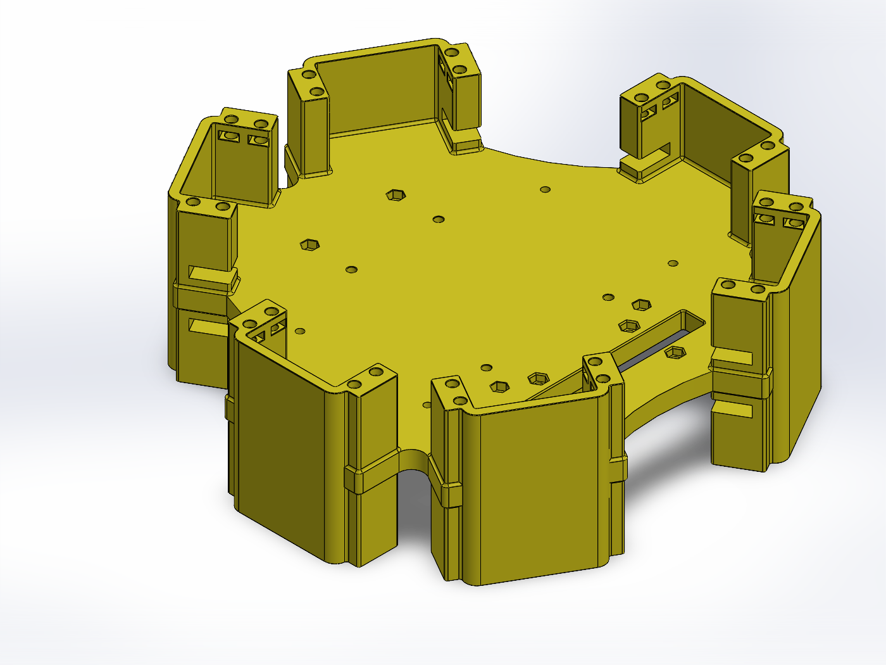

  

# HexaLoam — Open-Source 3D-Printable Hexapod Robot (SOLIDWORKS, MG996R, LiDAR, MATLAB)

  
  
  
  
  

**HexaLoam is an open-source, fully 3D-printable hexapod robot (hexabot) with native editable SOLIDWORKS CAD**, suited to agricultural scouting and plant-inspection projects, education, and legged-robot research. It has 18 joints (3 per leg: coxa, femur, tibia) driven by 36 low-cost MG996R servos, two back-to-back per joint, and a PLA+ structure of 5 STL designs (20 printed pieces, 1.306 kg as sliced). The chassis CAD integrates an RP-Lidar (2D) mount and cover for 2D SLAM. The repository also provides STEP, STL, 3MF and GLB files, MATLAB Simscape Multibody and URDF models, four controller configurations (Arduino Mega, ESP32 + 2x PCA9685, Raspberry Pi + 1 or 2 ESP32), 15 wiring diagrams, firmware, a Raspberry Pi Python and ROS 2 controller, and a torque analysis, under the MIT license. **There is no camera mount or plant-vision code yet;** the [agricultural plant-inspection guide](docs/agricultural-plant-inspection.md) shows how to add them.

**Tested in four controller configurations (A-D) by simulation:** simulation parameters and an analysis of the mass of each configuration's controllers and top-mounted parts were compared with the torque each set of motors needs, per gait. See the [configuration and torque table](#electronics-firmware-wiring--torque-analysis). These are analytical and simulation results; physical bench tests are still pending.

[Project homepage and research overview](https://equesai.github.io/HexaLoam/)

**Watch the hexapod walk** · [Gait comparison hub](https://equesai.github.io/HexaLoam/videos/) · [Tripod gait](https://equesai.github.io/HexaLoam/videos/tripod/) · [Ripple gait](https://equesai.github.io/HexaLoam/videos/ripple/) · [Wave gait](https://equesai.github.io/HexaLoam/videos/wave/) · [Reproduce the animations](docs/walking.md#reproduce-the-videos)

[360° assembly video](docs/media/assembly-orbit.mp4?raw=1) · [Multi-angle CAD gallery](docs/gallery.md)

This is a **mechanical starting point**. The designer is expected to finish the robot around the intended application, including the payload, mounting adapters, actuators, controller, battery, wiring, firmware, and validation.

[Designer guide and examples](docs/designer-guide.md) · [Main SOLIDWORKS assembly](Full_Robot_Assembly.SLDASM) · [STL and 3MF print files](Printables/)

## Is HexaLoam right for my project?

| Requirement | HexaLoam |
| --- | --- |
| Native SOLIDWORKS design you can edit | Yes: [Full_Robot_Assembly.SLDASM](Full_Robot_Assembly.SLDASM), [Designed/](Designed/) |
| Fully 3D-printable body | Yes: 20 PLA+ pieces from 5 STL designs |
| Cheap servo motors | Yes: 36 MG996R (2 per joint, 18 joints) |
| LiDAR already in the body design | Yes: RP-Lidar (2D) mount and cover in the chassis CAD |
| MATLAB / Simulink simulation files | Yes: Simscape Multibody export, single-leg study, gait replay, URDF (29 extra 6-DOF joints still to be mated, see below) |
| Camera vision for plant defects | Not included: no camera mount or vision code. [Guide to add them](docs/agricultural-plant-inspection.md) |
| Open license | Yes: [MIT](LICENSE) |
| Physically validated | Not yet: simulation and analysis only, hardware tests pending |

## Start developing

| If you want to… | Start here |
| --- | --- |
| Bring a chassis or leg mesh into Unity or Unreal Engine | [Visual assets and import instructions](docs/simulation-guide.md#visual-meshes) |
| Study how a foot force loads three joints | [Runnable MATLAB example](docs/simulation-guide.md#single-leg-static-study) |
| Change a gait and render it from the assembly geometry | [Walking demonstrations and reproduction commands](docs/walking.md#reproduce-the-videos) |
| Develop the complete 18-joint model and agricultural experiment | [Engineering roadmap and acceptance tests](docs/development-roadmap.md) |
| Build an agricultural plant-inspection robot with a camera | [Agricultural plant-inspection guide](docs/agricultural-plant-inspection.md) |
| Share a modification, classroom exercise or benchmark | [Contribution guide](CONTRIBUTING.md) · [Citation metadata](CITATION.cff) |

## Example applications

| Field | Example project | What the designer would add |
| --- | --- | --- |
| Agricultural robotics | Greenhouse or crop-row scouting and plant-defect inspection ([guide](docs/agricultural-plant-inspection.md)) | A camera (not yet in the CAD), a protective mount, vision software, and clearance for plants and soil |
| Inspection | Visual checks in a workshop or equipment aisle | A camera, lighting, and a mount that keeps the payload clear of the legs |
| Mapping | Indoor LiDAR scanning and mapping experiments | A controller or onboard computer, sensor integration, and mapping software |
| Education | A classroom hexapod for studying gait and kinematics | A controller, servo power, and firmware for repeatable gait exercises |
| Robotics research | Comparing locomotion on different surfaces | An IMU or other instrumentation, data logging, and repeatable test setups |

These are example configurations for designing a build. In addition to the mechanical CAD, the repository now includes complete electronics schematics, firmware, Raspberry Pi control software, URDF, and progressive testing guides—with software checks passing, weight and torque figures marked as analytical estimates, and physical hardware tests marked pending until bench assembly.

## Electronics, firmware, wiring & torque analysis

HexaLoam shares one canonical 18-joint mapping ([JOINT_MAPPING.md](control/robot-configuration/JOINT_MAPPING.md), [hexaloam_config.json](control/robot-configuration/hexaloam_config.json)) and CAD-derived 3R kinematics (`L1 = 86.53 mm`, `L2 = 121.06 mm`, `L3 = 202.50 mm`) across four electronic control configurations:

| Configuration | Controller & Bus | Top + 3S LiPo (kg) | Total Mass (kg) | Wave 5-Leg (N·m) | Ripple 4-Leg (N·m) | Tripod 3-Leg (N·m) | Max Extra Payload (70% Wave / Ripple) |
|---|---|---:|---:|---:|---:|---:|---|
| **A — Standalone Mega** | Arduino Mega 2560 (`D22..D39`) | 0.507 | 3.793 | 0.971 (45.0%) | 1.266 (58.7%) | 1.759 (81.5%) | **+2.11 kg** / **+0.73 kg** |
| **B — Standalone ESP32** | ESP32 + Dual PCA9685 (`0x40`, `0x41`) | 0.519 | 3.805 | 0.974 (45.1%) | 1.270 (58.9%) | 1.764 (81.8%) | **+2.10 kg** / **+0.72 kg** |
| **C — RPi + 1× ESP32** | Raspberry Pi 4/5 + ESP32 (`460800 baud`) + RP-Lidar | 0.703 | 3.989 | 1.021 (47.3%) | 1.332 (61.7%) | 1.850 (85.7%) | **+1.91 kg** / **+0.53 kg** |
| **D — RPi + 2× ESP32** | Raspberry Pi 4/5 + Left/Right ESP32s (`0x40` each) | 0.733 | 4.019 | 1.029 (47.7%) | 1.342 (62.2%) | 1.864 (86.4%) | **+1.88 kg** / **+0.50 kg** |

- **Mass & Dual-Motor Torque (analytical estimate, not measured on hardware):** Using slicer-reported Bambu Studio PLA+ weights (G-code not included in this repository; support negated: `Robot_Base` `174.67 g`, `L1` `59.64 g × 6`, `L2` `48.33 g × 6`, `L3` `73.51 g × 6`, `LidarCover` `42.68 g` = `1.306 kg`) + 36 MG996R servos (`1.980 kg`, 2 motors/joint = `2.157 N·m` stall @ 6.0 V) + 3S 5000 mAh LiPo (`0.360 kg`). Ripple (`58.7%–62.2%`) and Wave (`45.0%–47.7%`) stay inside the `70%` continuous thermal limit with **`+0.50 to +2.11 kg`** of extra payload headroom. **Tripod (3-leg support) needs `81.5%–86.4%` of stall torque, above the `70%` continuous limit**, so Ripple and Wave are the loaded-walking gaits; use Tripod only for short, unloaded runs. The Raspberry Pi controller (`gait_engine.py`) and the quickstart default to Tripod, so select Ripple or Wave before loading the robot. Servo mass basis: CAD model `33.9 g` vs datasheet `55 g`; totals use `55 g`.

- **15 Engineering Wiring Diagrams (SVG / PNG / PDF / Netlist):** [electronics/wiring/](electronics/wiring/) · [Connection Tables](electronics/connection-tables/) · [Power & Fuse Engineering](electronics/power/POWER_ENGINEERING.md) · [BOM](electronics/bom/BOM.md)
- **Firmware & Software:** [Arduino 01–14 Examples](firmware/arduino/examples/) · [ESP32 Generic Actuator Slave](firmware/esp32/actuator-slave/) · [Raspberry Pi Python & ROS2 Controller](software/raspberry-pi/) · [Protocol Spec](control/communication-protocol/README.md) · [URDF](simulation/urdf/hexaloam.urdf)
- **Trajectories & Progressive Testing:** [Tripod / Ripple / Wave CSV & JSON](demonstrations/) · [11-Stage Hardware Commissioning](testing/) · [All 6 Edition Packages](packages/)

## FAQ

**Is HexaLoam open source?** Yes. Everything is under the [MIT License](LICENSE); third-party reference CAD (servo, LiDAR, battery) keeps its own source terms.

**Which CAD does it use?** Native, editable SOLIDWORKS parts and assemblies (`Full_Robot_Assembly.SLDASM`, `LegMates.SLDASM`, `Designed/`), plus STEP, STL, 3MF and GLB.

**Which servos, and how many?** 36 MG996R servos: 18 joints (3 per leg), two back-to-back per joint (`MA1`, and `MA2 = 3000 - MA1` microseconds, mirrored). Two give 2.157 N·m stall torque per joint at 6.0 V.

**Is the body fully 3D printable?** The structure is: 5 STL designs make 20 PLA+ pieces (1.306 kg as sliced, supports excluded). Servos, fasteners, electronics and battery are bought parts.

**Can MATLAB simulate it?** Yes. A Simscape Multibody XML export with STEP files, a single-leg static study, a gait-trajectory replay and a URDF for `importrobot` are included. The Simscape import currently has 29 extra 6-DOF joints from missing CAD mates (`tools/check_cad_mates.py` explains them), so use the URDF for a clean 18-joint kinematic model. See the [simulation guide](docs/simulation-guide.md).

**How is the LiDAR mounted?** The chassis CAD includes an RP-Lidar (2D) model and an editable cover (`LidarCover`). A 2D lidar supports 2D SLAM (for example `slam_toolbox`). "LOAM" in the name is not a claim of 3D LOAM odometry.

**Can I add a camera for plant disease detection?** Not out of the box: there is no camera mount in the CAD and no vision code yet. The [guide](docs/agricultural-plant-inspection.md) covers camera placement, a YOLO-style detection pipeline, severity scoring, SLAM geotagging and a MATLAB digital-twin path.

**Which controller should I choose?** Four configurations (A: Arduino Mega, B: ESP32 + 2x PCA9685, C: Raspberry Pi + 1 ESP32, D: Raspberry Pi + 2 ESP32) are compared in the [table above](#electronics-firmware-wiring--torque-analysis). Use C or D for a camera.

**Is it validated?** By simulation and analysis only: mass and torque per configuration and gait are analytical estimates (wave and ripple within 70 % of continuous torque, tripod 81-86 %). Physical bench and field tests are marked pending in [testing/](testing/).

## Adapt the chassis

The base is **controller-agnostic** by design. Its central area provides room to place a controller and batteries selected for the application. Multiple mounting holes and pockets for **M3 nuts** give designers options for attaching brackets, adapter plates, covers, and payloads. Choose the mounting locations that suit your layout, then check the actual controller, battery, and fastener dimensions in CAD before printing.

The reference CAD locates an RP-Lidar model on the chassis and includes an editable cover. Designers can adapt the mount for their own sensor and verify its field of view and cable clearance. See the [designer guide](docs/designer-guide.md) for mounting and integration steps.

## Which parts are 3D printable?

The files cover the **custom printed structure**. Five STL designs make up 20 printed pieces for one robot. A working build also needs separate servos, fasteners, a controller, batteries and power hardware, and any chosen sensors.

| Part | Quantity | Approximate STL dimensions (X × Y × Z, mm) |
| --- | ---: | --- |
| [Robot base](Printables/Robot_Base.STL) | 1 | 203.5 × 68.0 × 208.9 |
| [Leg link L1](Printables/L1.STL) | 6 | 119.9 × 123.0 × 120.0 |
| [Leg link L2](Printables/L2.STL) | 6 | 158.6 × 64.8 × 39.4 |
| [Leg link L3](Printables/L3.STL) | 6 | 246.2 × 50.0 × 120.0 |
| [LiDAR cover](Printables/LidarCover.STL) | 1 | 111.3 × 63.0 × 77.5 |

The five STL meshes are watertight and consistently wound. The dimensions describe each part in its exported orientation. Review how rotation, supports, and adhesion affect the build volume for your printer.

## Print the parts

1. Open [Full_Robot.3mf](Printables/Full_Robot.3mf) in Bambu Studio. The file contains six plate layouts and a Bambu Lab X1 Carbon profile with a 0.4 mm nozzle.
2. Select your printer and material profile, then check orientation, supports, and printability. L3 measures about 246 mm along its longest exported axis.
3. For another slicer, import the [individual STLs](Printables/) in millimeters and use the quantities above.
4. Print one leg set and check the fit with your actual hardware before printing the remaining five.

## Open and inspect the CAD

1. Clone the repository or download its ZIP from GitHub's **Code** menu, keeping the folder layout intact.
2. Open [Full_Robot_Assembly.SLDASM](Full_Robot_Assembly.SLDASM) in SOLIDWORKS. Use [LegMates.SLDASM](LegMates.SLDASM) to inspect a single leg. The leg assembly may prompt for a rebuild.
3. Look in [Designed/](Designed/) for the editable robot parts and [Common/](Common/) for the servo, LiDAR, and battery reference models if SOLIDWORKS prompts for references.

The repository includes all dependencies reported for the main robot and leg assemblies. The CAD battery model (`Common/Battery_Related/Battery_Assembly_4S_3P.SLDASM`, a 4S3P 18650 pack) is a placeholder: the electrical design uses a 3S 5000 mAh LiPo. That reference assembly expects `18650 cells Spacers.step.SLDPRT`, which is absent from the source folder. The main robot assembly opens independently of that reference assembly.

## MATLAB and Simscape Multibody analysis

The assembly XML and seven STEP files imported and compiled in **MATLAB R2025b with Simscape Multibody**. The generated model contains **18 Revolute Joint blocks and 29 additional 6-DOF Joint blocks**. Cause: 11 of the 36 servos have no CAD mates and each leg is three unattached islands (`python tools/check_cad_mates.py simulation/cad-export/Full_Robot_Assembly.xml`). Fix: fix each servo case to its carrier part, mate each horn axis to the next link and re-export. Until then use [`simulation/urdf/hexaloam.urdf`](simulation/urdf/hexaloam.urdf) (MATLAB `importrobot`) as the clean 18-joint kinematic model. [CAD export](simulation/cad-export/) · [Import and verification guide](docs/simulation-guide.md#full-robot-and-agricultural-scene)

## Supporting CAD

The battery and LiDAR CAD files came from the `18650-li-ion-battery-6` and `rp-lidar-2` reference collections. The MG996R servo model came from the project team's reference CAD.

## License

Released under the [MIT License](LICENSE). Third-party reference CAD components remain subject to their respective source terms.
