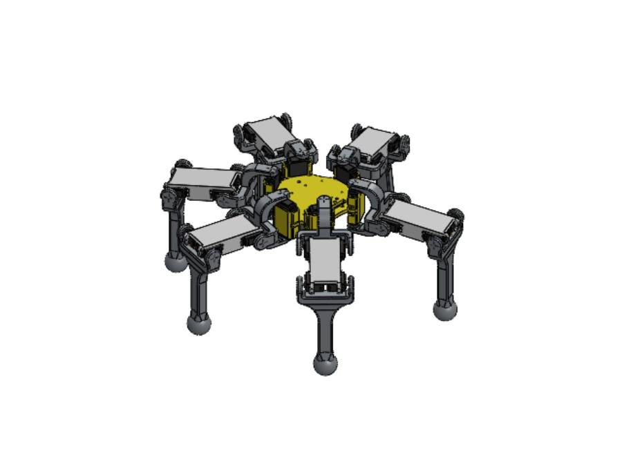

# HexaLoam — Agricultural Hexapod Robot with LiDAR

HexaLoam is a six-legged agricultural robot prototype, also called a hexabot. The design combines a **3D-printable chassis, leg links, and LiDAR cover** with MG996R servos and an RP-Lidar sensor modeled in the SOLIDWORKS assembly. The repository includes editable CAD, individual STL files, and a six-plate Bambu Studio project.

## Mechanical design and LiDAR configuration

- **Chassis.** The central base provides the structure for all six legs.
- **Legs.** Each leg uses the same three printed links, L1, L2, and L3. The leg assembly shows the link placement and servo interfaces in SOLIDWORKS.
- **LiDAR.** The main assembly positions an RP-Lidar model on the central chassis. A separate printable cover is included. The LiDAR configuration is mechanical and shows how the sensor fits into the robot. Sensor wiring, calibration, and software integration are outside the scope of this design.

The design is intended as a mechanical starting point for agricultural robotics experiments such as testing six-legged mobility and evaluating LiDAR placement for obstacle sensing. Autonomous navigation and field performance have yet to be demonstrated in this repository.

## What is 3D printable?

Along with the editable CAD, the repository provides **20 printable part instances** for the chassis, six leg sets, and LiDAR cover.

| Part | Quantity | Approximate STL dimensions (X × Y × Z, mm) |
| --- | ---: | --- |
| [Robot base](Printables/Robot_Base.STL) | 1 | 203.5 × 68.0 × 208.9 |
| [Leg link L1](Printables/L1.STL) | 6 | 119.9 × 123.0 × 120.0 |
| [Leg link L2](Printables/L2.STL) | 6 | 158.6 × 64.8 × 39.4 |
| [Leg link L3](Printables/L3.STL) | 6 | 246.2 × 50.0 × 120.0 |
| [LiDAR cover](Printables/LidarCover.STL) | 1 | 111.3 × 63.0 × 77.5 |

The five STL meshes are watertight and consistently wound. Dimensions describe each mesh in its exported orientation. Rotation, supports, and adhesion can change the build-plate space required.

A working robot also requires separate servos, a LiDAR sensor, fasteners, control electronics, and power hardware. The CAD is a mechanical prototype. Firmware, wiring diagrams, a complete purchasing bill of materials, and field-test results are outside the scope of this repository.

## Print the parts

1. Open [Full_Robot.3mf](Printables/Full_Robot.3mf) in Bambu Studio to see the six plate layouts. The embedded profile is for a Bambu Lab X1 Carbon with a 0.4 mm nozzle.
2. Select the profile for your own printer and material and review the build volume, orientation, supports, and clearances. Pay particular attention to L3, which measures about 246 mm along its longest exported axis.
3. For another slicer, import the five individual [STL files](Printables/) in millimeters and use the quantities above.
4. Print a single leg set and check fit with your hardware before printing the remaining five.

## Open and inspect the CAD

1. Clone the repository or download its ZIP from the **Code** menu on GitHub.
2. Keep the folder layout intact and open [Full_Robot_Assembly.SLDASM](Full_Robot_Assembly.SLDASM) in SOLIDWORKS.
3. Open [LegMates.SLDASM](LegMates.SLDASM) to inspect one leg. SOLIDWORKS may request a rebuild when opening it.
4. If SOLIDWORKS prompts for references, look in [Designed/](Designed/) for the robot parts and [Common/](Common/) for the servo, LiDAR, and battery reference models.

The repository includes all file dependencies reported for the main robot and leg assemblies. The separate 4S3P 18650 battery reference assembly expects `18650 cells Spacers.step.SLDPRT`, which is absent from the source folder. The main robot assembly can open without that reference assembly.

## Supporting CAD

The battery and LiDAR CAD files were carried over from the `18650-li-ion-battery-6` and `rp-lidar-2` reference collections. The MG996R servo model came from the project team's reference CAD. The repository has no blanket open-source license.
