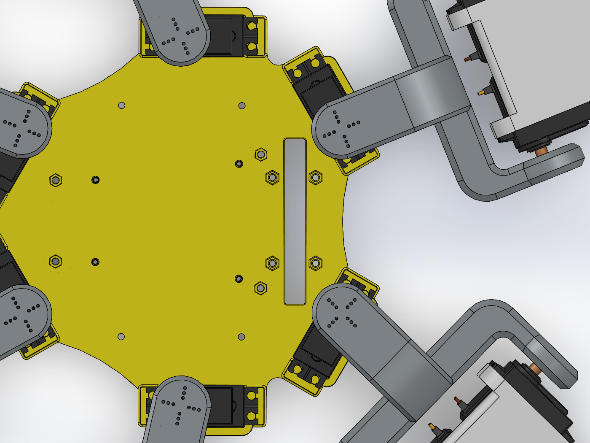
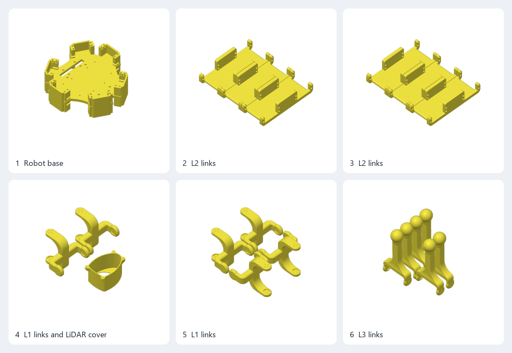

# HexaLoam designer guide

Use this guide to turn the [HexaLoam mechanical platform](../README.md) into a robot for a specific job. Start with the editable SOLIDWORKS assembly and make the payload, electronics, and mechanical decisions together. The following configurations are design examples.

## Design around the mounting features

1. **Choose the controller and batteries.** Start with [Robot_Base.SLDPRT](../Designed/Robot_Base.SLDPRT). Place the actual component envelopes in the chassis CAD, including connectors, cable bends, mounting brackets, and room to remove the batteries. The base is designed for a controller selected by the designer. Use an adapter plate or standoffs to match its footprint.
2. **Select the mounting points.** Use the existing holes and M3 nut pockets where they line up with your bracket or adapter. Use the overhead close-up and the [chassis render](../README.md#adapt-the-chassis) to orient yourself, then take measurements from the editable CAD. Check nut seating, screw length, screw-tip clearance, and tool access with the fasteners you intend to use. Print a small fit sample if tolerances are uncertain.
3. **Place the payload and route cables.** Check the full leg sweep and keep cables clear of moving joints. Place heavy components with balance and service access in mind. For LiDAR, check that the cover, brackets, cabling, and proposed payload leave the required scan area clear.
4. **Finish the robot for its job.** Select the actual actuators and power hardware. Design the wiring, firmware, gait control, and any sensing or navigation software. Confirm fit on the bench, test one leg through its range of motion, then test the assembled chassis with the intended payload before using it in its target environment.
5. **Document your build.** Record part revisions, the controller and battery models, fastener sizes, bracket CAD, wiring, firmware, print settings, and test results. Update the print files whenever a modified part changes.

## Example configurations

| Application | Proposed setup | First validation |
| --- | --- | --- |
| Agricultural scouting | Mount a row-facing camera or environmental sensor. Use LiDAR as a candidate ranging input if the layout and software call for it. Adapt the brackets and electronics cover to the operating conditions. | Bench-test the mounts, then check clearances and sensor visibility on a representative row or greenhouse aisle. |
| Facility inspection | Fit a camera and light to a removable bracket for visual checks around equipment. Choose control electronics for the intended operating method. | Verify camera angle, cable retention, and clearance with the legs in motion on a controlled test route. |
| Indoor mapping | Fit the chosen LiDAR and a computer capable of running the intended mapping stack. Design mounts around the sensor's scan plane and cable exit. | Verify scan coverage on a stationary chassis, then log a short controlled run. |
| Education | Use an accessible controller mount and a labeled wiring layout for servo control, gait sequencing, and kinematics exercises. | Test a single leg against known poses before running synchronized gait exercises. |
| Locomotion research | Add instrumentation such as an IMU and logging hardware. Use removable mounts when comparing payload or sensor arrangements. | Establish a repeatable baseline with fixed test surfaces, payload, and motion settings. |

## Print layout reference

The six plates below are taken from the [Bambu Studio project](../Printables/Full_Robot.3mf). Review the layout again if you modify the CAD or change printers.

## Simulation plan

The intended model has three single-axis revolute joints per leg, for 18 revolute joints and 18 leg degrees of freedom. This is a design target pending a successful import and verification of the joint topology.

1. Keep the Simscape Multibody XML export and its referenced STEP files together. Import the XML with MATLAB's `smimport` function. [MathWorks model-import documentation](https://www.mathworks.com/help/sm/ref/smimport.html)
2. Confirm that the imported model has three independent revolute joints per leg. Check the joint axes and initial positions against the CAD. Confirm that each leg moves independently and that no imported constraint locks an intended axis.
3. Specify the payload, joint limits, actuation, and motion inputs. For walking analysis, model the feet and ground contact before comparing different gaits.
4. Log joint angle, angular velocity, and actuator torque over the motion. Compare peak and sustained demand under representative payload and motion conditions, then check the estimates against bench measurements.
