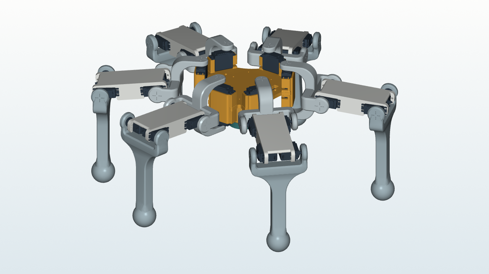
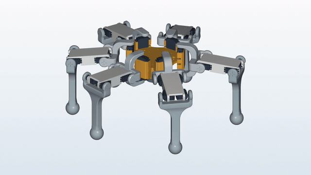
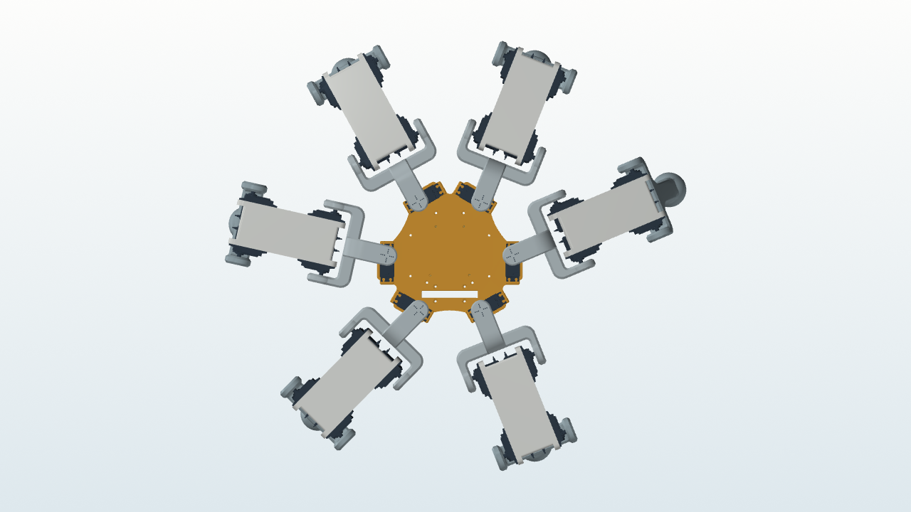
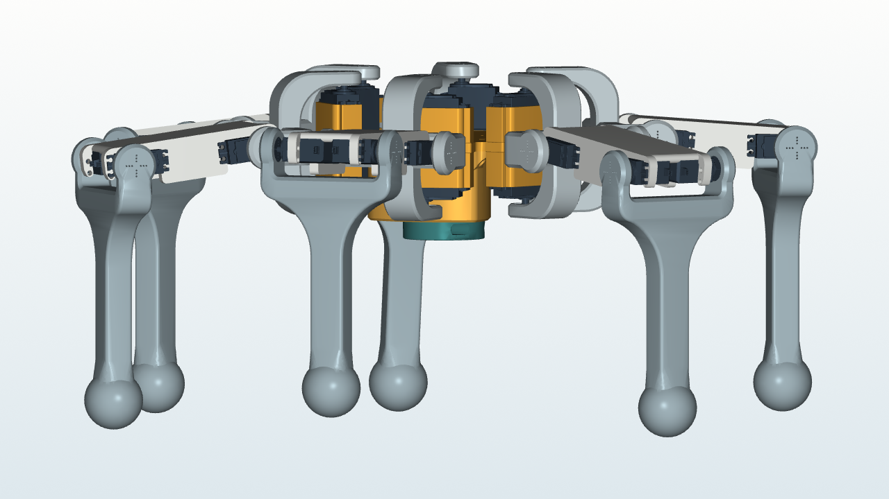
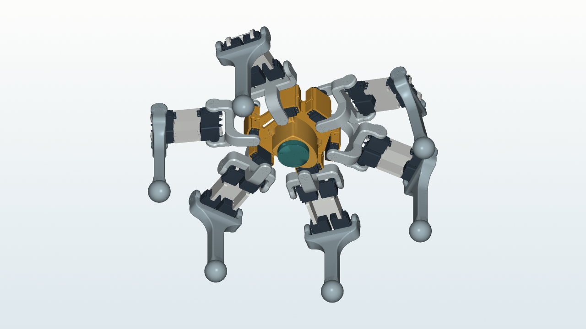

# HexaLoam assembly gallery

The 57 component instances are positioned from the SOLIDWORKS-to-Simscape XML export. The studio colors distinguish the printed structure and reference hardware. All images on this page are CAD renders. [Watch the three walking sequences](walking.md)

[Download the full-resolution turntable video](media/assembly-orbit.mp4?raw=1) · [Explore the XML and seven STEP geometries](../simulation/cad-export/)

Preview the 360° turntable

### Foot-link motion

The fixed-camera animation shows all six L3 links rotating through an illustrative ±15° cycle about their own CAD hinge axes. The angle is prescribed for visualization. This study makes no prediction about walking, contact, torque or physical travel limits. [Download the six-second motion study](media/distal-joint-sweep.mp4?raw=1)

| Overhead | Profile |
| --- | --- |
|  |  |
| Shows the six leg attachment positions around the chassis. | Shows the chassis height and the folded geometry of the links in the exported pose. |

### Underside

The underside view makes the lower chassis and the space between the legs easier to inspect. For part dimensions and mating features, use the [editable mechanical assembly](../Full_Robot_Assembly.SLDASM).
