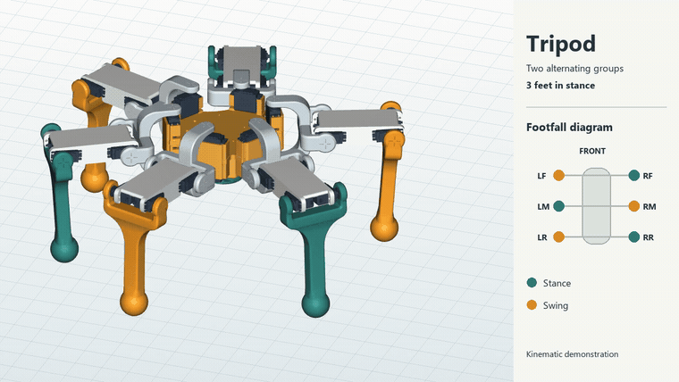
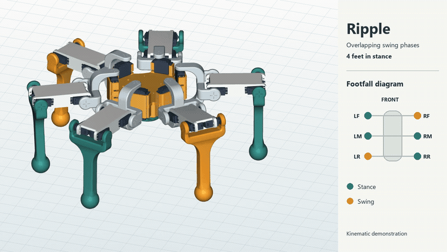
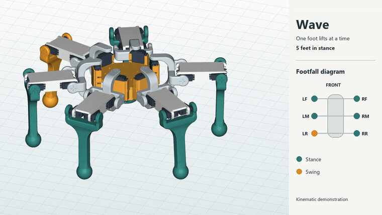

# Three walking sequences

These animations use the 57 CAD component instances and hip, pitch and knee axes from the assembly export. The body advances over a flat grid. A foot stays at its ground location through stance and moves forward and upward during swing. The diagram is viewed from above with the front at the top. Teal indicates stance and amber indicates swing.

| Gait | Feet in the stance phase | Visible difference |
| --- | ---: | --- |
| Tripod | 3 | Two groups of three exchange support together |
| Ripple | 4 | Lift-offs are staggered and two swing phases overlap |
| Wave | 5 | One foot finishes its swing before the next lifts |

## Tripod

The left front, right middle and left rear form one tripod. The right front, left middle and right rear form the other. Watch the three feet in one group hold their positions as the body advances.

[](media/gait-tripod.mp4?raw=1)

[Download the tripod video](media/gait-tripod.mp4?raw=1) · [Watch the narrated tripod Short on YouTube](https://www.youtube.com/shorts/4rD9bK5iIl8)

## Ripple

The lift-off order is left rear, right middle, left front, right rear, left middle, right front. The next foot begins lifting while the previous foot is still swinging. Two feet share the swing phase and four remain in stance.

[](media/gait-ripple.mp4?raw=1)

[Download the ripple video](media/gait-ripple.mp4?raw=1) · [Watch the narrated ripple Short on YouTube](https://www.youtube.com/shorts/ggAerDmc-yU)

## Wave

Only one foot swings at a time. Follow the amber marker from rear to middle to front on the left, then from rear to middle to front on the right. The other five feet remain in stance.

[](media/gait-wave.mp4?raw=1)

[Download the wave video](media/gait-wave.mp4?raw=1) · [Watch the narrated wave Short on YouTube](https://www.youtube.com/shorts/ZopVjcM9axM)

## Model scope

Each 10-second clip shows two five-second cycles at 24 frames per second. All three use the same prescribed 60 mm stride per cycle, 12 mm/s chassis speed and 22 mm peak foot clearance. The grid spacing is 50 mm. Across all 240 frames per gait, the CAD foot centers moved less than 0.001 mm between consecutive stance samples.

Foot paths and body speed are prescribed, and joint rotations are solved kinematically. The visual reconstruction groups servo cases with their intended chassis or leg segments. Ground contact forces, actuator torque, slip under load and real hardware performance remain open validation questions. The separate Simscape import compiles with 18 revolute and 29 additional 6-DOF joint blocks. [Simulation guide](simulation-guide.md#full-robot-and-agricultural-scene)

## Reproduce the videos

Use Python 3.12 and an FFmpeg executable with the `libx264` encoder on your path. Run the following from the repository root. The first script generates frame-by-frame world transforms in metres from the assembly XML. The second script draws the STEP geometry at those poses and writes three MP4 files into the render cache.

```sh
python -m pip install -r tools/render-requirements.txt
python tools/gait_motion.py --xml simulation/cad-export/Full_Robot_Assembly.xml --output .render-cache/poses
python tools/render_gaits.py --poses .render-cache/poses --cache .render-cache/meshes --output .render-cache/videos
```

To reproduce the stills and the turntable from the exported assembly pose, run `python tools/render_assembly.py --cache .render-cache/meshes --output .render-cache/gallery`. [Assembly gallery](gallery.md)
